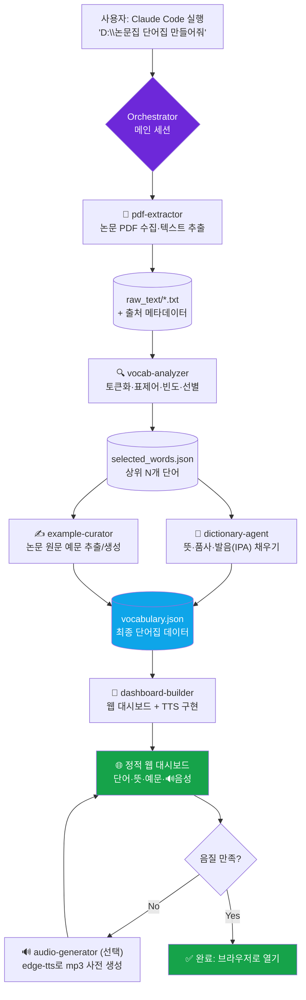
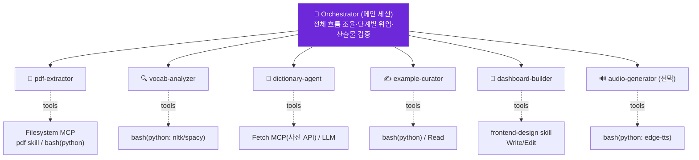

# 📚 PaperVoca — 논문 기반 영어 단어집 대시보드 기획서

> Claude Code 실행용 프로젝트 기획서 (Project Spec)
> 작성 목적: `D:\논문집` 폴더의 논문을 분석해 자주 쓰이는 단어로 단어집을 만들고,
> **단어 / 뜻 / 예문 / 음성 듣기**가 포함된 웹 대시보드로 제공하는 서비스 구현.

---

## 0. 핵심 가정 (Assumptions)

이 기획서는 아래 가정을 전제로 작성되었습니다. 다르면 해당 부분만 교체하세요.

| 항목 | 가정값 | 다를 경우 바꿀 곳 |
|------|--------|------------------|
| 논문 언어 | 영어 | `pdf-extractor`, `vocab-analyzer` |
| 단어 뜻 언어 | 한국어 | `dictionary-agent` (사전 소스) |
| 논문 형식 | PDF | `pdf-extractor` (docx면 docx skill 추가) |
| 실행 환경 | Windows + Claude Code | Filesystem MCP 경로 표기 |
| 목적 | 학술 영어 어휘 학습 | 단어 선별 전략(아래 2-2) |

---

## 1. 프로젝트 개요

**한 줄 정의:** 내 논문 폴더를 읽어, 학습 가치가 높은 단어를 자동 추출하고, 뜻·예문·발음을 갖춘 인터랙티브 단어집 웹 대시보드를 생성하는 로컬 도구.

**핵심 가치**
- 내가 실제로 읽는 논문에서 나온 단어 → 학습 동기 + 문맥 적합성이 높음
- 예문이 "실제 논문 속 문장"이라 그대로 독해에 도움
- 음성 듣기로 발음까지 학습

**산출물**
1. 단어집 데이터(JSON) — 단어/뜻/품사/발음/예문/출처
2. 웹 대시보드(정적 사이트) — 검색·필터·음성 재생
3. (선택) 단어집 엑셀/CSV 내보내기

---

## 2. 핵심 기능 명세

### 2-1. 논문 수집 & 텍스트 추출
- `D:\논문집` 내 모든 PDF를 재귀 탐색
- 각 PDF에서 본문 텍스트 추출 (헤더/푸터/참고문헌/수식 노이즈 최소화)
- 파일별 출처 메타데이터 보존(파일명, 페이지) → 예문 출처 표기에 사용

### 2-2. 단어 빈도 분석 & 선별 (품질의 핵심)
단순 빈도순이면 the, of, model 같은 단어만 나옵니다. 아래 파이프라인 권장:

1. 토큰화 → 소문자화 → 표제어 추출(lemmatization, 예: `studies → study`)
2. 불용어(stopwords) 제거 + 숫자/기호/1~2글자 토큰 제거
3. **학습 가치 필터링** (택1 또는 조합)
   - 일반 빈출 2,000~3,000 단어(기초어휘) 제외 → "어려운 단어"만 남김
   - 또는 AWL(Academic Word List) 교집합 → 학술 핵심어 우선
4. 빈도 + 분산도(여러 논문에 골고루 등장하는가) 점수화 → 상위 N개 선별
5. 사용자 조정 파라미터: `최소 등장 횟수`, `추출 단어 수`, `난이도 모드`

### 2-3. 뜻 / 품사 / 발음 생성
- 선별된 각 단어에 대해: 한국어 뜻, 품사, 발음기호(IPA)
- 소스 우선순위: ① 무료 사전 API → ② LLM 생성(문맥 기반 뜻) 폴백

### 2-4. 예문
- **우선: 논문 원문에서 해당 단어가 쓰인 실제 문장 추출**(출처 표기)
- 문장이 너무 길거나 없으면 LLM이 간결한 학습용 예문 생성

### 2-5. 웹 대시보드
- 카드/리스트 뷰: 단어 · 뜻 · 품사 · 발음 · 예문 · 출처
- 🔊 **음성 듣기 버튼** (단어 발음 + 예문 읽기)
- 검색, 품사/난이도/출처 논문별 필터, 정렬(빈도·알파벳)
- (선택) 즐겨찾기/암기 체크, 다크모드

**음성(TTS) 구현 방식 — 2가지 옵션**

| 방식 | 장점 | 단점 | 추천 |
|------|------|------|------|
| **A. 브라우저 Web Speech API** (`speechSynthesis`) | 무료·키 불필요·백엔드 없음·즉시 재생 | 음질이 OS/브라우저 의존 | ✅ MVP 기본값 |
| **B. edge-tts로 mp3 사전 생성** (Python, 무료) | 음질 우수·오프라인 재생 | 빌드 시 음성 파일 생성 단계 필요 | 고도화 시 |

> MVP는 A로 시작 → 음질이 아쉬우면 B로 업그레이드 권장.

---

## 3. 데이터 스키마 (vocabulary.json)

```json
{
  "meta": {
    "generated_at": "2026-06-02",
    "source_dir": "D:/논문집",
    "paper_count": 12,
    "word_count": 200
  },
  "words": [
    {
      "id": "w001",
      "word": "robust",
      "lemma": "robust",
      "pos": "adjective",
      "ipa": "/roʊˈbʌst/",
      "meaning_ko": "강건한, 견고한 (외부 변화에도 성능이 유지되는)",
      "frequency": 47,
      "doc_spread": 8,
      "difficulty": "academic",
      "examples": [
        {
          "sentence": "The proposed method remains robust under noisy conditions.",
          "source": "2023_Kim_DeepLearning.pdf",
          "page": 5,
          "type": "from_paper"
        }
      ],
      "audio": { "mode": "web_speech", "file": null }
    }
  ]
}
```

---

## 4. WorkFlow 차트



---

## 5. Subagents 구조

Claude Code의 **서브에이전트**는 각자 독립된 컨텍스트 창과 전용 시스템 프롬프트·도구 권한을 갖는 전문 에이전트입니다. 메인 세션(Orchestrator)이 단계별로 적절한 서브에이전트에게 작업을 위임합니다.



### 서브에이전트 정의표

| 에이전트 | 역할 | 입력 → 출력 | 권장 도구/스킬 |
|----------|------|------------|----------------|
| **pdf-extractor** | 논문 수집 & 텍스트 추출, 출처 메타데이터 보존 | `D:\논문집\*.pdf` → `raw_text/*.txt` | Filesystem MCP, `pdf` skill, bash(pymupdf/pdfplumber) |
| **vocab-analyzer** | 토큰화·표제어·불용어 제거·빈도/분산 점수·학습가치 필터 → 단어 선별 | `raw_text/` → `selected_words.json` | bash(python: nltk 또는 spacy), AWL/빈출어 리스트 |
| **dictionary-agent** | 단어별 한국어 뜻·품사·IPA 채우기 (사전 우선, LLM 폴백) | `selected_words.json` → 뜻 보강 | Fetch MCP(무료 사전 API), LLM |
| **example-curator** | 논문 원문에서 해당 단어 예문 추출(출처 포함), 없으면 LLM 생성 | `raw_text/` + 단어 → `examples` | bash(python: 문장 분리), Read |
| **dashboard-builder** | 단어집 JSON으로 정적 웹 대시보드 생성 + TTS 연결 | `vocabulary.json` → `/web` | **frontend-design skill**, Write/Edit |
| **audio-generator** (선택) | edge-tts로 단어/예문 mp3 사전 생성 | `vocabulary.json` → `/web/audio/*.mp3` | bash(python: edge-tts) |

> **서브에이전트 정의 위치(참고):** 프로젝트 기준 `.claude/agents/<name>.md`,
> 사용자 기준 `~/.claude/agents/<name>.md`. 각 파일은 YAML frontmatter(`name`, `description`, `tools`)와 시스템 프롬프트 본문으로 구성합니다.
> 정확한 최신 사양은 공식 문서에서 확인하세요 → https://docs.claude.com/en/docs/claude-code/overview

#### 서브에이전트 파일 예시 (`.claude/agents/vocab-analyzer.md`)
```markdown
---
name: vocab-analyzer
description: 추출된 논문 텍스트에서 표제어화·불용어 제거 후 학습 가치가 높은 단어를 빈도·분산 기준으로 선별한다. 단어 추출 단계에서 사용.
tools: Bash, Read, Write
---

너는 학술 어휘 선별 전문가다. raw_text/ 의 .txt 파일을 읽어:
1. spaCy로 토큰화·표제어 추출, 불용어/숫자/1~2글자 제거
2. 기초 빈출어 2,000개를 제외해 '학습 가치 높은' 단어만 남김
3. (빈도 × 등장 논문 수)로 점수화해 상위 N개 선별
4. 결과를 selected_words.json 스키마로 저장
파라미터(min_freq, top_n, difficulty)는 사용자 지정값을 따른다.
```

---

## 6. 권장 MCP

| MCP | 필요성 | 용도 | 비고 |
|-----|--------|------|------|
| **Filesystem MCP** | ⭐ 필수 | `D:\논문집` 등 작업 폴더 밖 경로를 Claude Code에 읽기 권한 부여 | 공식 서버. 허용 디렉터리에 `D:\논문집` 등록 |
| **Fetch MCP** | 선택 | 무료 사전 API 호출(뜻·발음 보강) | 사전 API를 LLM 폴백으로 쓰면 생략 가능 |

**설정 예시 (`.mcp.json`)**
```json
{
  "mcpServers": {
    "filesystem": {
      "command": "npx",
      "args": ["-y", "@modelcontextprotocol/server-filesystem", "D:\\논문집", "."]
    }
  }
}
```
> 또는 CLI: `claude mcp add` 로 등록. 윈도우 경로는 백슬래시 이스케이프(`\\`) 주의.
> 사전을 LLM으로 처리하면 MCP는 Filesystem 하나로도 충분합니다.

---

## 7. 권장 Skills

| Skill | 종류 | 용도 |
|-------|------|------|
| **pdf** | 내장(public) | 논문 PDF 텍스트·표·이미지 추출 (`pdf-extractor`의 핵심) |
| **frontend-design** | 내장(public) | 깔끔한 단어집 대시보드 UI 생성 (`dashboard-builder`) |
| **xlsx** | 내장(public) · 선택 | 단어집을 엑셀/CSV로도 내보내고 싶을 때 |
| **vocab-extraction** (신규 제안) | 커스텀 | 단어 선별 방법론(불용어·표제어·AWL·점수식·출력 스키마)을 고정해 매번 동일 품질 보장 |

**커스텀 Skill 제안 — `vocab-extraction`**
- 단어 추출은 반복 실행되고 "방법론의 일관성"이 품질을 좌우하므로 Skill로 캡슐화하기 좋은 작업입니다.
- 담을 내용: 표준 불용어 리스트, 표제어 규칙, 기초 빈출어 제외 리스트, 점수 공식, `selected_words.json` 스키마, 파라미터 기본값.
- 생성 방법: Claude Code에서 skill-creator로 생성하거나 `.claude/skills/vocab-extraction/SKILL.md` 직접 작성.

---

## 8. 기술 스택 (제안)

| 영역 | 기술 |
|------|------|
| PDF 추출 | Python `pymupdf`(fitz) 또는 `pdfplumber` |
| NLP/빈도 | Python `spacy`(en_core_web_sm) 또는 `nltk` |
| 단어집 데이터 | JSON (정적) |
| 프론트엔드 | 정적 HTML+JS 또는 React 단일 파일 (빌드리스) |
| 음성 | Web Speech API(MVP) → `edge-tts`(고도화) |
| 배포 | 로컬 정적 파일 (브라우저로 `index.html` 열기) |

---

## 9. 디렉토리 구조 (제안)

```
papervoca/
├─ .claude/
│  ├─ agents/
│  │  ├─ pdf-extractor.md
│  │  ├─ vocab-analyzer.md
│  │  ├─ dictionary-agent.md
│  │  ├─ example-curator.md
│  │  ├─ dashboard-builder.md
│  │  └─ audio-generator.md      # 선택
│  └─ skills/
│     └─ vocab-extraction/SKILL.md   # 커스텀(선택)
├─ .mcp.json                      # Filesystem MCP 설정
├─ raw_text/                      # 추출된 논문 텍스트(중간 산출물)
├─ data/
│  ├─ selected_words.json
│  └─ vocabulary.json             # 최종 단어집
├─ web/
│  ├─ index.html                  # 대시보드
│  ├─ app.js
│  ├─ style.css
│  └─ audio/                      # edge-tts mp3(선택)
└─ scripts/                       # 파이썬 유틸(추출·분석)
```

---

## 10. 단계별 구현 로드맵 (Claude Code에서)

1. **환경 준비** — `.mcp.json`에 Filesystem MCP로 `D:\논문집` 등록, `.claude/agents/` 작성
2. **추출** — `pdf-extractor`로 PDF → `raw_text/` + 출처 메타데이터
3. **선별** — `vocab-analyzer`로 단어 선별 → `selected_words.json` (파라미터 조정하며 품질 확인)
4. **보강** — `dictionary-agent`(뜻·품사·IPA) + `example-curator`(예문) → `vocabulary.json`
5. **대시보드** — `dashboard-builder`로 `web/` 생성, Web Speech API로 음성 연결
6. **검수** — 브라우저로 열어 단어·뜻·예문·음성 확인
7. **(선택) 고도화** — `audio-generator`로 mp3 사전 생성, 엑셀 내보내기, 즐겨찾기/암기체크

---

## 11. 첫 실행용 프롬프트 (Claude Code에 그대로 붙여넣기)

```
이 기획서(논문단어집_대시보드_기획서.md)를 읽고 PaperVoca를 구현해줘.
1) .mcp.json에 Filesystem MCP로 D:\논문집 을 등록하고
2) .claude/agents/ 에 6개 서브에이전트를 만들고
3) pdf-extractor → vocab-analyzer 순으로 D:\논문집 의 PDF에서 상위 200개 단어를 선별해줘.
   - 기초 빈출 2,000단어는 제외, 학술 단어 우선, 최소 등장 3회
4) dictionary-agent와 example-curator로 vocabulary.json을 완성해줘 (예문은 논문 원문 우선)
5) dashboard-builder로 단어/뜻/예문/음성듣기(Web Speech API) 대시보드를 web/ 에 만들어줘.
먼저 1~3단계만 하고 selected_words.json 결과를 보여준 뒤 멈춰줘.
```

---

### 부록: 검증용 공식 문서
- Claude Code 개요: https://docs.claude.com/en/docs/claude-code/overview
- Claude Code 문서맵: https://docs.anthropic.com/en/docs/claude-code/claude_code_docs_map.md

> ⚠️ 서브에이전트/MCP/Skills의 세부 설정 형식은 업데이트될 수 있으니, 실제 구현 직전 위 공식 문서로 한 번 더 확인하세요.
1